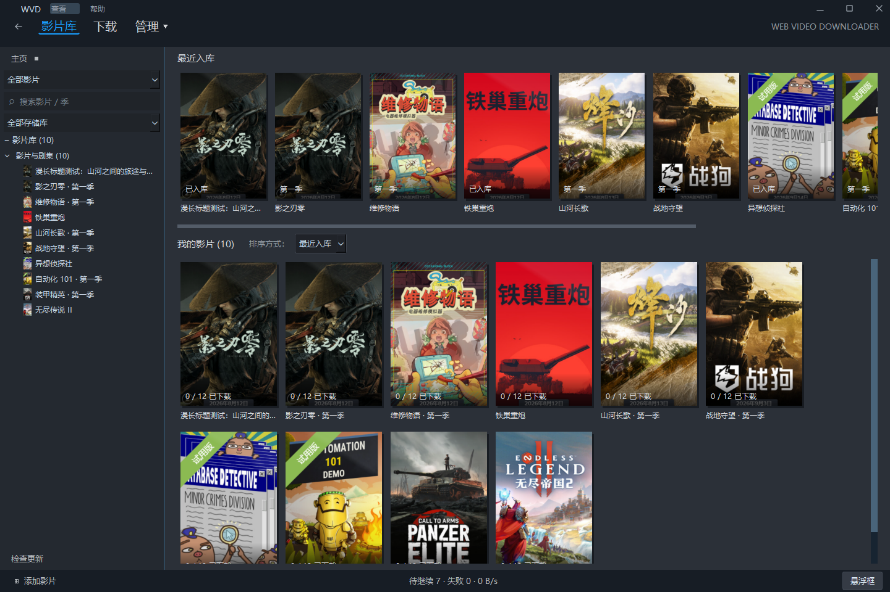
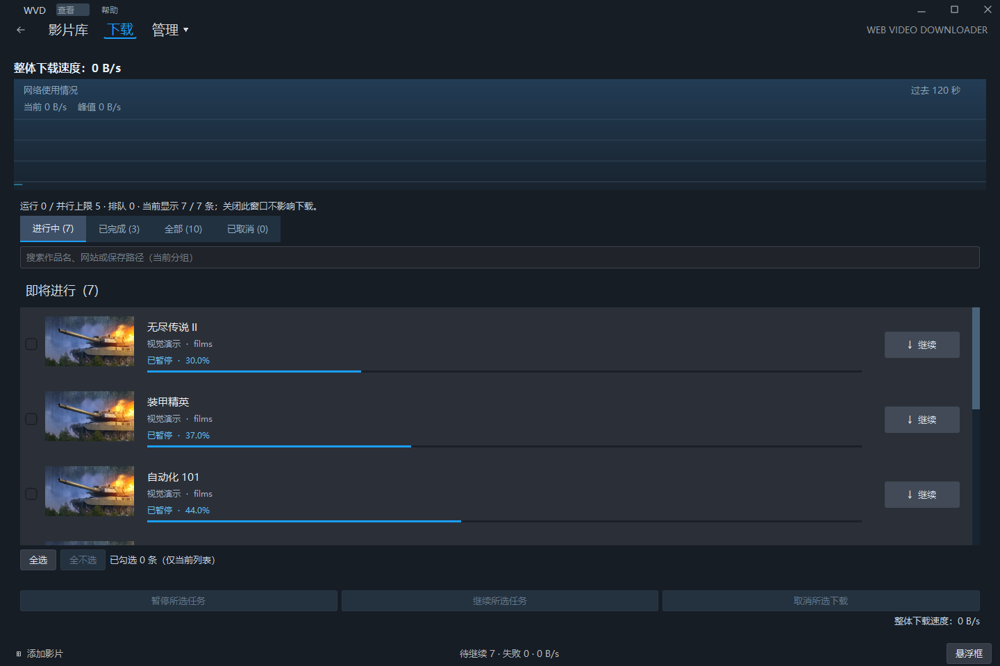
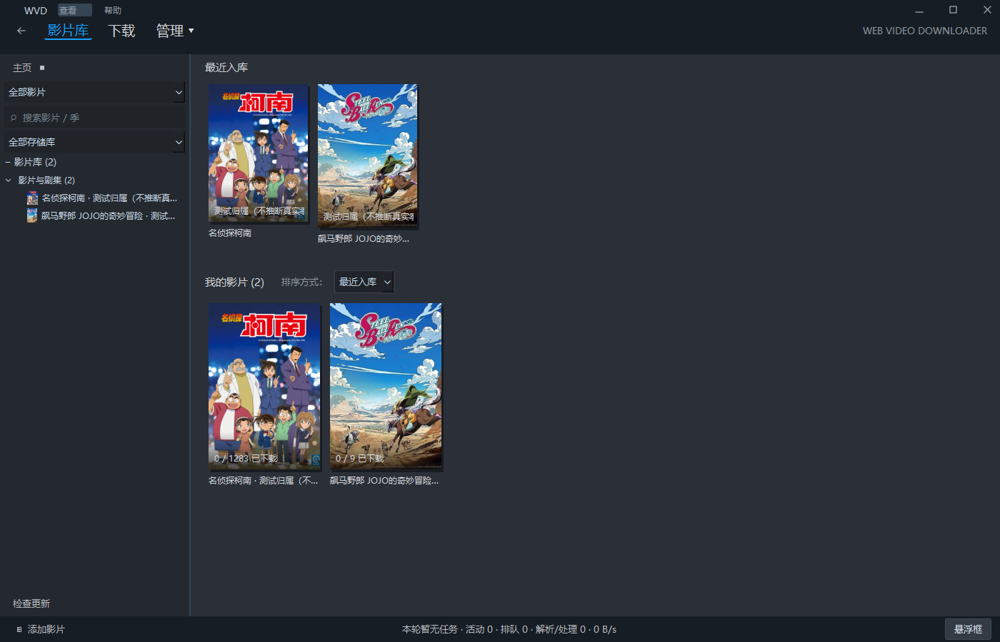

# v0.15.0 验证与整体验收

日期：2026-11-17。目标为 Windows PySide6 客户端，因此构建和原生界面验证在 Windows 本机进行。总需求 #27 保持打开，以下为模型自检，不代表用户已验收。

## 真实界面对照

[离线对照报告](../design/steam-review/index.html) 包含用户提供的 Steam 原图、v0.14.0 实际旧界面、重构后实际 Qt 窗口，以及空库、小窗口、150% 缩放。图片可点击查看原尺寸。

固定布局数据的封面裁片只用于比对，不是内置影片内容。演示文件不是可播放媒体，不能用这些截图声称完成真实下载。产品运行时依然使用原站封面、本地更换图片或缺图占位。

迭代发现并修复：旧式顶部与侧栏、巨大空矩形、任务页残留侧栏、标签栏白底、封面拉伸、详情空间挤占、添加页白底、存储空间信息密度与长路径问题。保留 WVD 品牌和影片语义，不加入 Steam 商店、好友、成就或社区。

## 功能回归

- `python -X utf8 -m unittest discover -s tests`：177 项通过（138.601 秒）。
- 最后界面调整后的存储、影片库、任务和托盘专项：10 项通过；任务目录快捷动作回归通过。
- 两项竞态的持久化/Qt worker 专项：5 项通过。
- 大合集独立压力连续 20 轮通过；Qt worker 原生退出复现修复后连续 10 轮通过。不通过的前轮结果已用于定位，没有用重跑通过掩盖失败。
- 现有批量、1001 集分页、取消后不入队、逐季播放确认、原位导入、队列、续传、本地 HTTP 分片/限速、更新准备/回退和单实例测试继续通过。

本轮没有重新登录会员账号或重新完整下载 AGE/B站全片；此前真实下载证据见 v0.14.0 验证报告。本轮不扩展适配站点，也不声称所有网站链接均可下载。

## 审查：Standards

明确项目约定违反：0。两项判断建议均已处理：窗口框架只负责原生移动/边缘缩放，响应布局归 Workspace；存储查询限制为一个后台 worker，连续切换只保留最新待查请求，关闭后禁止回写。后台查询不扫描目录、不在 GUI 线程等待磁盘系统调用。

## 审查：Spec

发现一项明确视觉缺陷：添加页保留白底，导致白标题不可读。修复后重新检查 100% 与 150% 真实截图。未发现需要增加的新业务范围。

任务列表的快捷入口只打开结果所在目录，播放继续由季详情的外部播放器与逐季确认规则管理。关闭、最大化、返回等控件补有可读名称与键盘焦点；文字按钮对比度做了调整。

## 压力测试发现的实际缺陷

- #33：Windows 中普通 JSON 读取句柄会阻止原子替换，造成 25 集中的一集保存失败。现在进程内读写同步，使用独立临时文件；仅对短暂 Windows 共享错误做总 150ms 的有界重试，永久失败保留旧记录并清理自身临时文件。
- #34：QThread.finished 可能早于原生线程清理完成。现在收到 finished 后确认 join 完成再报告空闲，保留 GUI 线程回调与取消语义。

## 构建检查

一次开发增量构建复用了旧 PYZ 缓存，实际 EXE 中 task_view 与最终源码不符，已在发布前拦截。正式构建使用现有 `build.ps1` 的清洁构建，并增加 `verify_bundle.py`：直接比较主入口、所有随包本项目模块的代码对象及安装脚本字节；发现不一致立即失败。旧包已实际触发该检查失败。

最终清洁构建通过：主入口、42 个随包本项目模块及安装脚本全部与最终源码一致。

## 最终 EXE 与真实增量安装

- 完整 Windows x64 包约 307.53 MiB；v0.14.0 → v0.15.0 增量包约 10.27 MiB。
- 解压实际 v0.14.0 发布包，再使用本次实际增量包组装 payload，全部目标文件通过校验。
- 在一次性 D 盘目录运行真实独立更新窗口，保留影片库索引和封面。安装、新 EXE 主窗口可见、v0.15.0 版本与本次启动令牌确认通过，更新窗口自动关闭，全部安装目标文件复核通过。
- 本机一次样本安装总耗时约 27.99 秒，其中安装文件约 1.21 秒、新版启动确认约 1.91 秒；3,258 个未变程序文件跳过复制。这不是对所有硬盘和设备的耗时承诺。
- 一次性安装、payload 和本次备份在验证后清理。用户正在使用的目录未替换；测试没有向旧用户数据目录写入程序数据。

发布为供验收的预发布版本，不自动把未验收 UI 切换为正式稳定更新；总 Issue #27 仍保持打开。

新增 UI skills 用于最后的焦点、控件名称、文字对比度、多尺寸及一致性检查。网页/手机专用规则不用于改写已确认的 Steam 桌面设计，也不把网页检测器没有分析 Qt 当作通过。

## 用户验收路径

1. 在新的完整程序目录运行 EXE；查看空库、添加/导入入口、顶部和窗口控制。
2. 用自己的影片入库后检查侧栏、封面架、筛选与排序，进入季详情检查播放确认和选集动作。
3. 查看下载任务、批量操作、速度趋势及完成后状态；调整窗口大小和 Windows 缩放。
4. 打开设置、存储空间、账号及更新窗口，检查文字、布局和入口是否符合预期。

程序不附带对照报告里的演示条目，不覆盖用户当前使用目录。鼠标长拖动与不同显示器硬件组合未做人工全覆盖；原生系统移动/缩放已经接入，标题区双击最大化/还原经过 Qt 原生窗口事件测试。

原版 Steam 与本程序具有不同业务内容；固定最近/全部陈列架尚不包含任意自定义架编辑。Qt 字体栅格化与原生控件细节可能不同，不编造“90%”分数。待用户整体验收后再决定正式发布状态。
