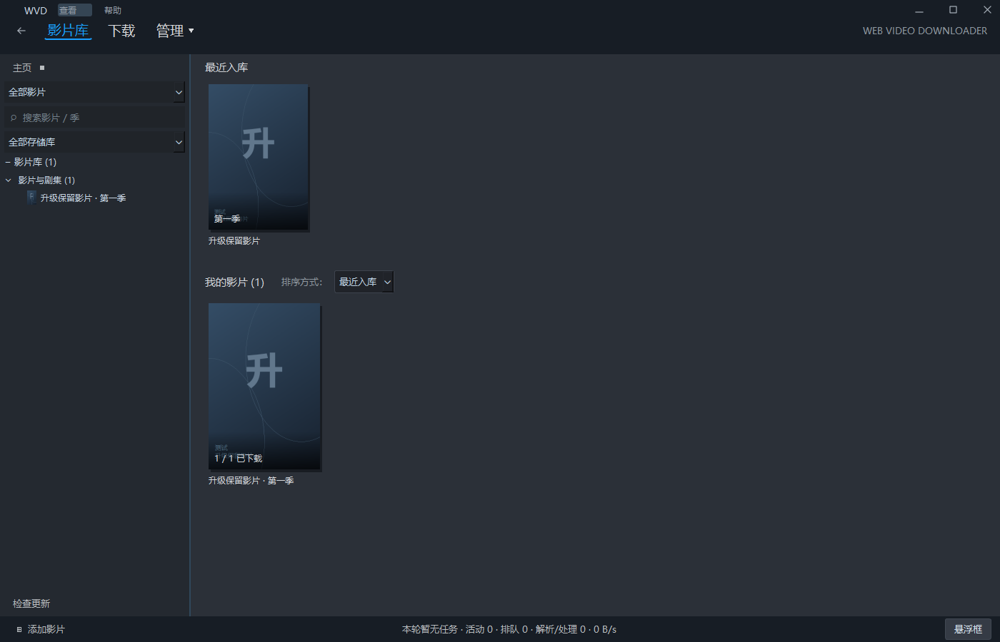
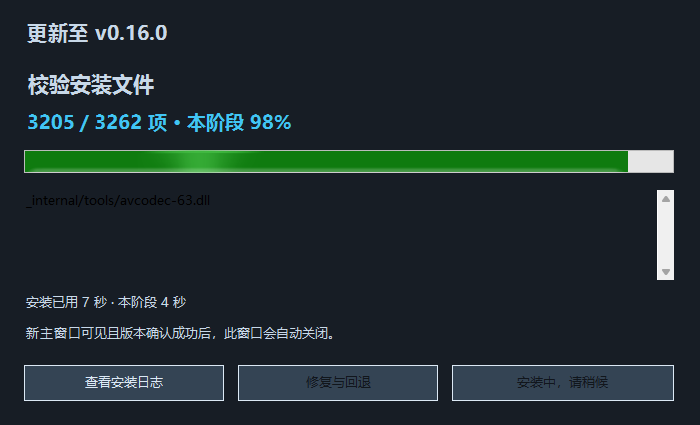
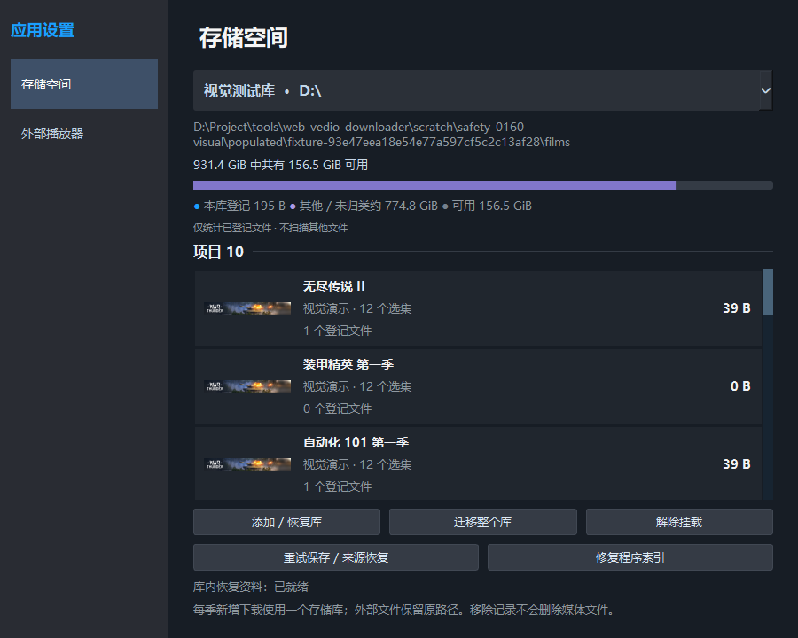

# v0.16.0 数据安全与库恢复验证

日期：2026-11-17。项目为 Windows PySide6 客户端，原生界面、构建和安装验证在 Windows 本机完成。#27 继续待用户整体验收，本报告不是用户验收结论。

## 完成内容

#35：构建输出与稳定运行目录分离；发现用户资料时停止构建和打包。安装、回退、修复的程序清单拒绝用户数据、影片和库元数据。实际构建发现 Playwright 声明文件与视频分片都以 `.ts` 结尾，已限定四个明确依赖文件的白名单，普通 `.ts` 影片仍拒绝。

#36：库自带当前资料、来源清单、去重封面及最近3份有效历史。添加预览、原库搬家、独立副本、整库迁移预览和复制校验、损坏只读、资料重试、中央索引重建均已接入界面。未完成任务在恢复后暂停，不自动执行；只读挂载的任务在恢复写权限后必须显式恢复，不能被重存空任务覆盖。

库外引用、删除权限和物理位置分开保存。解除挂载保留库目录；移除作品同步当前元数据并保留媒体。跨程序写者互斥和异常退出接管不增加正常操作步骤。

## 自动回归

- 最终完整测试：`python -X utf8 -m unittest discover -s tests`，**266项通过，189.483秒**。
- 覆盖身份、封面、偏好、来源、相对路径、手动改位置、独立副本、任务及缓存、历史/来源回退、只读/离线、保存失败重试、损坏索引、目录联接、嵌套库、不同写者和事务故障回滚。
- 真实 Qt 工作流通过：添加恢复 → 不自动入队 → 迁移范围与大小预览 → 整库迁移 → 任务输出/缓存重定位 → 损坏程序索引 → 保留原件重建 → 重新添加恢复。
- 安装成功、注入失败、真实 PowerShell 独立修复与本地回退保留用户文件；紧凑备份兼容旧完整备份，复用文件损坏时拒绝回退，未知文件不参与清理。
- 断点验证保留旧片段：可验证 HTTP Range 才继续；服务器不支持续传、无可靠验证器或链接失效时停止，不静默覆盖。

## 审查及修正

**Standards**：无明确项目约定违反；路径链接检查的重复实现已集中到共用边界。

**Spec**：补齐迁移前范围/大小预览，以及只读挂载后待恢复任务的事务处理。进一步故障审查修正旧嵌套库存储迁移、URL及身份字段中的访问凭据、损坏历史挤占有效历史等问题。

实际安装审查发现旧安装器仍复制所有程序文件。已改为只备份实际将替换/删除的原件；未变化文件在离线回退时按旧清单校验并复用。失败还原仍保留实际原字节，而不是假定旧程序未损坏。

## 最终发布包与原生安装

- Windows x64 完整包 **322,545,558字节，约307.60 MiB**；数据兼容版本4，从0.13.0/0.14.0/0.15.0使用完整包，不提供不兼容数据版本的在线回退。
- 清洁构建通过主入口、**47个本项目冻结模块**与安装脚本的源码一致性校验。构建位于 `build/release-output`，原有 `dist` 数据未清理。
- 从真实v0.14.0发布包建立隔离旧安装，使用本次完整包运行真实独立安装窗口；新版窗口可见、版本号及启动令牌确认成功，更新窗口自动关闭，完整安装目录校验通过。
- 影片、字幕、程序私有文件、作品/选集身份、本季播放设置和库内恢复资料均保留。没有向测试环境旧C盘用户目录写入便携数据。
- 此次原生样本耗时 **50.245秒**，回退备份 **13,084,899字节，约12.48 MiB**；**3,256个未变化文件未复制进备份**。这些是本机一次样本，不是所有机器的耗时保证。

首次原生安装测试漏建隔离缓存的归属标记，导致客户端按安全规则不确认启动；补齐与真实准备流程相同的标记后，重新运行完整安装通过。未用静态图或只启动进程代替确认。失败测试生成的已识别发布文件按清单和哈希清理，未知文件及诊断记录保留。

存储管理截图使用隔离的界面数据；冻结EXE截图中影片文件是保护字节的哨兵，不能据此宣称完成影片下载或全片解码。本轮不新增网站适配，也没有重新进行会员登录/真实全片下载。

## 验收路径与限制

从“管理 → 存储库与播放器”添加专用目录，入库后退出，再在独立新程序数据目录添加同一库，核对身份、封面、设置和现有文件。可进一步验证手动搬家、独立副本和软件迁移；先用少量测试媒体体验，不要求清除现有用户数据。

恢复后的非空缓存目前仅好看视频HTTP路径支持可验证续传，其他引擎明确停止并保留片段。来源失效、自定义信息完全丢失、整盘故障或整个库被删除不能保证恢复；本次用户已自行删除的旧测试数据不作恢复承诺。
